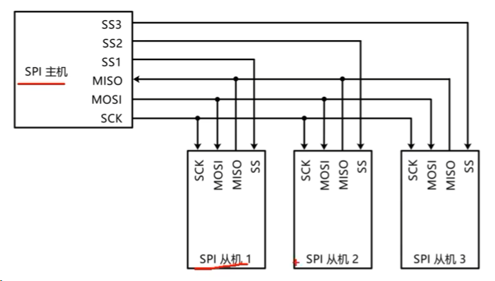
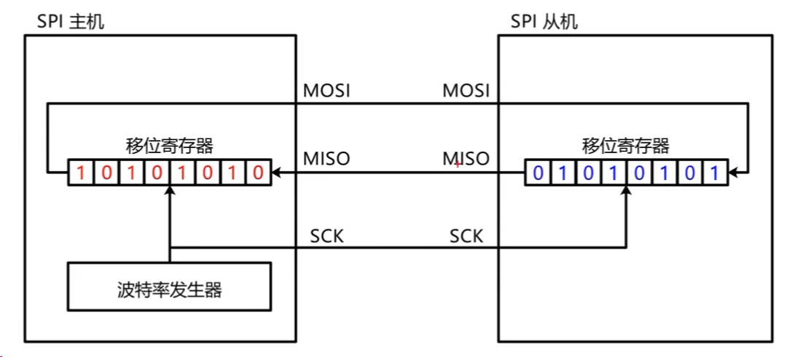
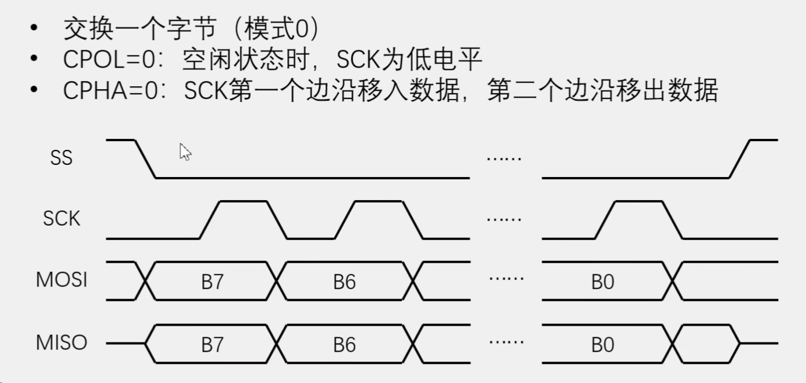
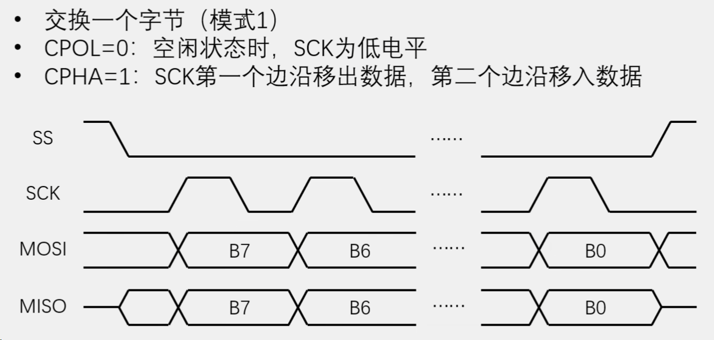
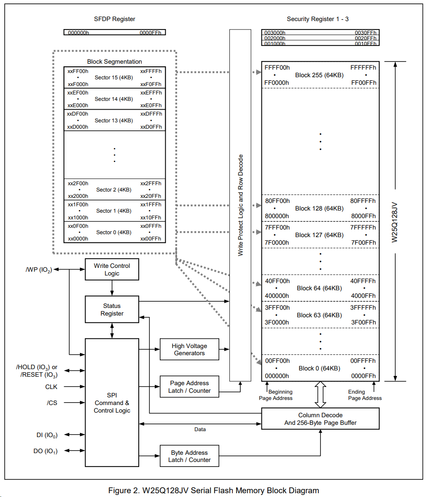

## SPI 基础知识

SPI 是一种**同步、全双工**的串行通信接口，常见连接方式是一主多从。主机产生时钟，通过各自独立的片选线选择从机。

| 信号线 | 含义 | 作用 |
| --- | --- | --- |
| SCK | Serial Clock | 时钟，由主机产生 |
| MOSI | Master Out Slave In | 主机发送，从机接收 |
| MISO | Master In Slave Out | 从机发送，主机接收 |
| SS / CS | Slave Select / Chip Select | 从机片选，本文以低电平有效为例 |

### 移位与全双工传输

以图中的**高位先行**（MSB first）为例：主机移位寄存器的最高位经 MOSI 送入从机的最低位，从机的最高位经 MISO 送入主机的最低位，两个移位寄存器形成一个数据交换的“圈”。

在时钟控制下，主从机同时发送、接收，完成一个字节的交换。位序需要双方一致，并非所有 SPI 设备都固定为高位先行。

## SPI 时钟模式

CPOL（时钟极性）和 CPHA（时钟相位）分别取 0 或 1，共形成**四种模式**。CPOL 决定 SCK 的空闲电平（0 为低、1 为高），CPHA 决定在哪个时钟边沿采样：

| 模式 | CPOL / CPHA | 采样 | 移出 |
| --- | --- | --- | --- |
| 0 | 0 / 0 | 上升沿 | 下降沿 |
| 1 | 0 / 1 | 下降沿 | 上升沿 |
| 2 | 1 / 0 | 下降沿 | 上升沿 |
| 3 | 1 / 1 | 上升沿 | 下降沿 |

主从机必须使用相同的时钟模式。下面结合原图记录模式 0 和模式 1 的时序。

### 模式 0：上升沿采样

SS 拉低后选中从机，首位数据需要在第一个 SCK 上升沿之前准备好。随后主从机在**上升沿采样移入数据，在下降沿移出下一位数据**。

### 模式 1：下降沿采样

SS 拉低表示选中从机，在整个传输过程中保持低电平。主从机在**第一个上升沿移出首位数据，在下降沿采样移入数据**，随后重复，直到传输完毕。

为了避免多个从机同时驱动 MISO，未选中的从机应释放 MISO，使其处于高阻态；选中后按器件规定的时序输出数据。数据在采样边沿附近应保持稳定，不能简单理解为“高电平传输”。

## W25Q128 Flash

采用 W25Q128 学习 SPI Flash 的读写。它是一种低成本、小型化的非易失性存储器，断电后仍能保留数据。下图为 **W25Q128JV**，本文按该型号的普通 SPI 操作说明，使用 24 位地址；具体操作应核对实际芯片型号。

### 存储结构

W25Q128JV 的容量为 128 Mbit，即 16 MiB。按图中的 64 KiB 块划分，存储层级由大到小为：

**块（Block）→ 扇区（Sector）→ 页（Page）**。

| 单元 | 大小 | 关系 |
| --- | --- | --- |
| 块（图中的 64 KiB Block） | 64 KiB | 包含 16 个扇区 |
| 扇区（Sector） | 4 KiB | 包含 16 页，是最小擦除单元 |
| 页（Page） | 256 字节 | 页编程的数据边界 |

芯片还支持 32 KiB 块擦除和整片擦除。

### Flash 操作注意事项

**写入与擦除：**

1. 每次页编程或擦除前，必须先发送**写使能**（Write Enable）指令。
2. 编程只能将数据位由 **1 写为 0**；要从 0 恢复为 1，必须擦除。
3. 按手册要求，向已擦除的位置写入数据；擦除后每一位均为 1，即每字节为 `0xFF`。不必在每次写入前重复擦除整个扇区，但覆盖旧数据前应先处理擦除需求。
4. 擦除必须按照器件支持的单元进行，最小为 4 KiB 扇区，不能按单字节擦除。
5. 单次页编程最多发送 256 字节，且**不能跨越当前页边界**。从页内偏移处开始时，只能写到本页末尾；继续发送会回绕到页首，覆盖本次传入页缓冲区的数据，因此跨页写入必须拆分。
6. 页编程或擦除启动后，芯片进入忙状态，应读取状态寄存器中的 `BUSY` 位，等待其清零后再进行普通读写；忙状态并非完全不响应指令，仍可读取状态寄存器。

**读取：**

直接读取数据，无需写使能，读取后也不会进入忙状态。普通读取应等待 `BUSY = 0`；若使用擦除/编程暂停功能，需遵守手册中的暂停与读取限制。

