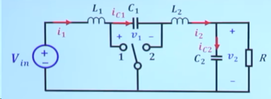
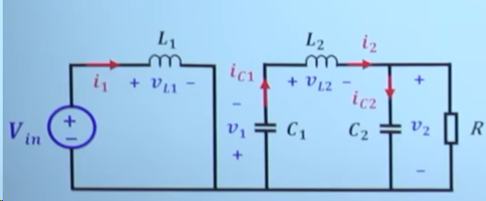
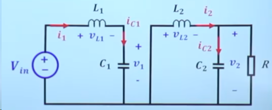
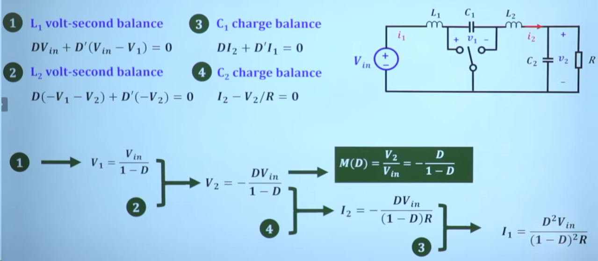
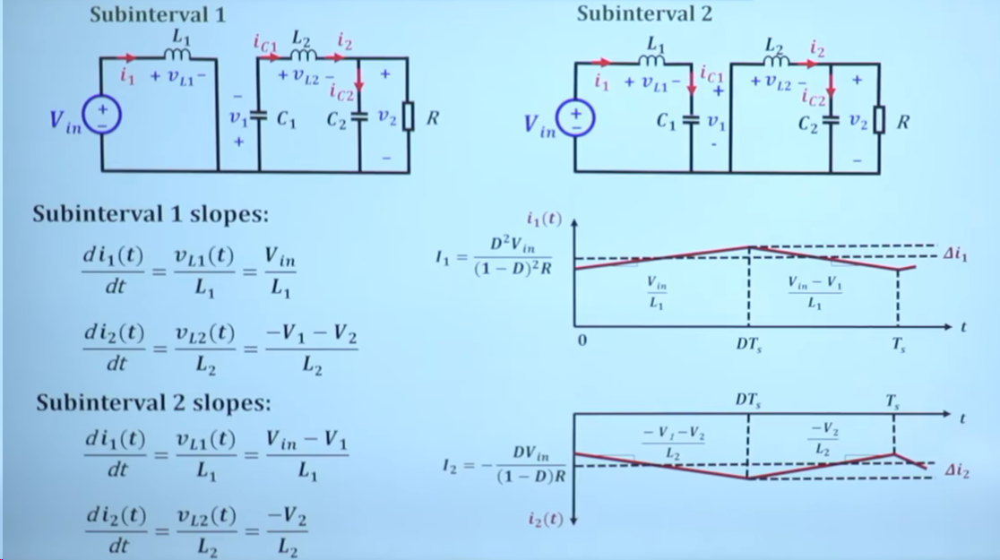
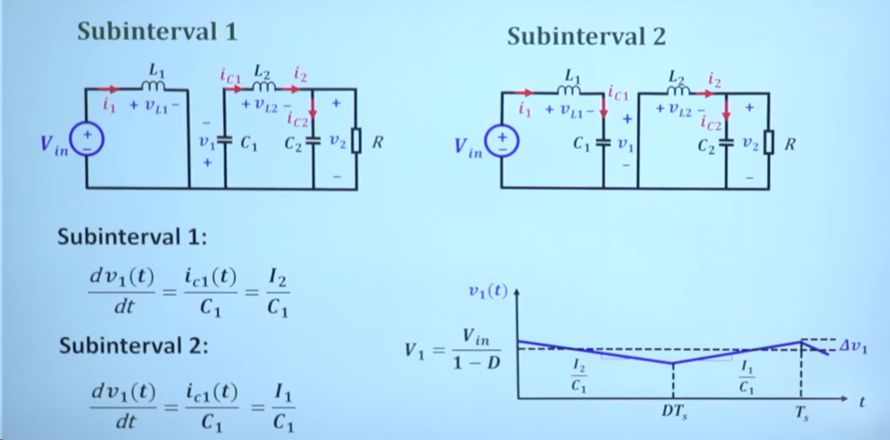

## 1. 基本拓扑

Cuk（Ćuk）变换电路通过耦合电容 $C_1$ 传递能量，$L_1$、$L_2$ 分别平滑输入和输出电流，$C_2$ 为输出滤波电容，$R$ 为负载电阻。

以下分析采用理想器件，假设电路处于稳态、连续导通模式（CCM），并采用小纹波近似。设开关接至位置 1 的时间占比为 $D$，开关周期为 $T_s$，开关频率为 $f_s=1/T_s$，其中 $0<D<1$。

电压、电流的参考方向均按图中标注：$v_1$、$v_2$ 和 $i_1$、$i_2$ 表示瞬时值，$V_1$、$V_2$ 和 $I_1$、$I_2$ 表示周期平均值。输出电压 $V_2$ 为负，按图中参考方向定义的 $I_2$ 也为负；负号表示实际方向与参考方向相反。

### 1.1 开关状态 1：开关接至位置 1

此状态持续 $DT_s$。输入电源向 $L_1$ 储能，$C_1$ 向输出侧释放能量。

电感电压和电容电流为：

$$
\begin{aligned}
v_{L_1} &= V_{\mathrm{in}}, \\
v_{L_2} &= -v_1-v_2, \\
i_{C_1} &= i_2, \\
i_{C_2} &= i_2-\frac{v_2}{R}.
\end{aligned}
$$

由于 $i_2$ 在此参考方向下为负，$i_{C_1}=i_2$ 对应 $C_1$ 放电。

### 1.2 开关状态 2：开关接至位置 2

此状态持续 $(1-D)T_s$。输入侧向 $C_1$ 充电，$L_2$ 的电流经位置 2 所接的回路续流。

电感电压和电容电流为：

$$
\begin{aligned}
v_{L_1} &= V_{\mathrm{in}}-v_1, \\
v_{L_2} &= -v_2, \\
i_{C_1} &= i_1, \\
i_{C_2} &= i_2-\frac{v_2}{R}.
\end{aligned}
$$

两种状态下都有 $i_{C_2}=i_2-v_2/R$。稳态时为零的是电容电流的**周期平均值**，而不是瞬时值；瞬时电流的变化正是输出电压产生纹波的原因。

### 1.3 伏秒平衡与电荷平衡

在稳态下，电感两端电压的周期平均值为零，电容电流的周期平均值也为零。采用小纹波近似，可用平均值写出：

$$
\begin{aligned}
L_1:\quad & D V_{\mathrm{in}}+(1-D)(V_{\mathrm{in}}-V_1)=0, \\
L_2:\quad & D(-V_1-V_2)+(1-D)(-V_2)=0, \\
C_1:\quad & D I_2+(1-D)I_1=0, \\
C_2:\quad & I_2-\frac{V_2}{R}=0.
\end{aligned}
$$

由 $L_1$、$L_2$ 的伏秒平衡得到：

$$
V_1=\frac{V_{\mathrm{in}}}{1-D},\qquad V_2=-\frac{D}{1-D}V_{\mathrm{in}}.
$$

因此，理想稳态、连续导通模式下的电压变换比为：

$$
\boxed{\displaystyle M(D)=\frac{V_2}{V_{\mathrm{in}}}=-\frac{D}{1-D}}
$$

负号表示输出电压相对于输入反相。$D<0.5$ 时输出电压幅值小于输入，$D>0.5$ 时输出电压幅值大于输入。

由 $C_2$、$C_1$ 的电荷平衡得到：

$$
\begin{aligned}
I_2 &= \frac{V_2}{R}=-\frac{D V_{\mathrm{in}}}{(1-D)R}, \\
I_1 &= -\frac{D}{1-D}I_2
     =\frac{D^2 V_{\mathrm{in}}}{(1-D)^2R}.
\end{aligned}
$$

### 1.4 纹波求解

求解纹波可以根据允许的电流、电压纹波选取电感和电容。下文统一用 $\Delta i_{1,\mathrm{pp}}$、$\Delta i_{2,\mathrm{pp}}$ 和 $\Delta v_{1,\mathrm{pp}}$ 表示纹波的**峰峰值**，即一个周期内最大值与最小值之差。

**电感电流纹波**

根据电感两端电压，由 $\mathrm{d}i/\mathrm{d}t=v_L/L$ 求出电流变化斜率：

状态 1 下，$v_{L_1}\approx V_{\mathrm{in}}$；由稳态结果可得 $v_{L_2}\approx -V_1-V_2=-V_{\mathrm{in}}$。因此，两个电感的电流纹波峰峰值分别为：

$$
\begin{aligned}
\Delta i_{1,\mathrm{pp}} &\approx \frac{V_{\mathrm{in}}D T_s}{L_1}
=\frac{V_{\mathrm{in}}D}{L_1 f_s}, \\
\Delta i_{2,\mathrm{pp}} &\approx \frac{V_{\mathrm{in}}D T_s}{L_2}
=\frac{V_{\mathrm{in}}D}{L_2 f_s}.
\end{aligned}
$$

状态 1 下 $i_1$ 上升、$i_2$ 下降，状态 2 下则相反。虽然 $i_2$ 的平均值为负，纹波峰峰值仍取正值。

**耦合电容电压纹波**

根据电容电流，由 $\mathrm{d}v_1/\mathrm{d}t=i_{C_1}/C_1$ 求出电压变化斜率：

小纹波近似下，状态 1 的电压斜率为 $I_2/C_1<0$，状态 2 的电压斜率为 $I_1/C_1>0$。根据充放电的电荷平衡：

$$
\begin{aligned}
\Delta v_{1,\mathrm{pp}}
&\approx \frac{|I_2|D T_s}{C_1} \\
&=\frac{I_1(1-D)T_s}{C_1} \\
&=\frac{|I_2|D}{C_1 f_s}.
\end{aligned}
$$

以上纹波公式采用理想模型并忽略电容 ESR 的影响；图中的 $\Delta i_1$、$\Delta i_2$、$\Delta v_1$ 均对应上述峰峰值。

