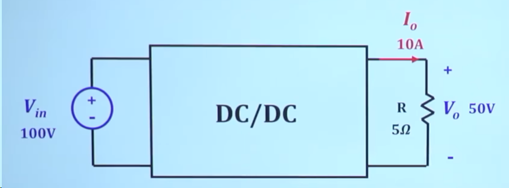
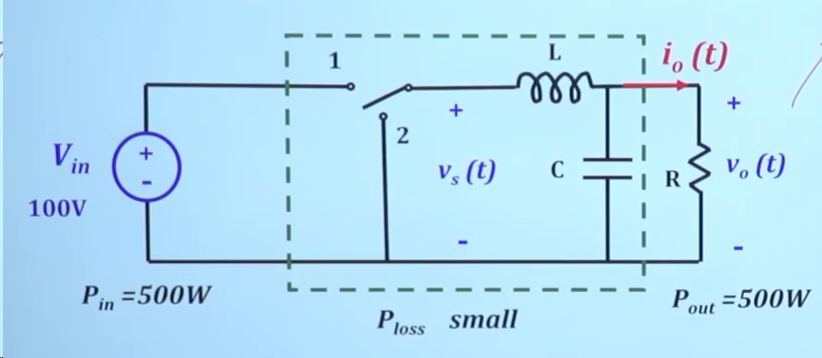
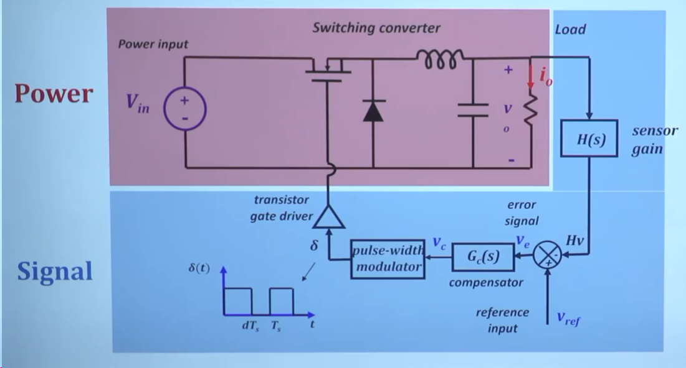
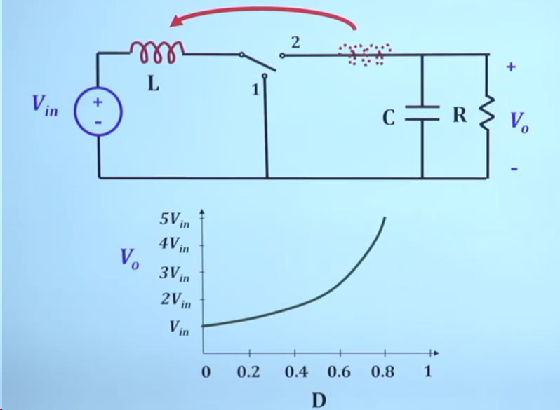

## 1. 从电阻降压到开关降压

希望将 100 V 的直流电源通过 DC/DC 变换，得到 50 V、10 A 的输出。

最简单的办法是在负载前串联一个电阻降压，但损耗很大，而且输出电压会随负载电流变化。因此，采用开关周期性通断，再添加 LC 滤波器，将开关节点的方波电压滤成纹波较小的直流输出。

## 2. 输出反馈与闭环控制

一个完整的控制系统还需要对输出量进行采样，将采样值与参考值比较，通过负反馈调节开关的占空比，使输出保持在目标值附近。

## 3. 从降压拓扑到升压拓扑

将电感放到输入侧，并按下图调整开关连接，就形成了 Boost 升压拓扑。

电感电流不能突变。以开关接到图中位置 1 为导通状态：

- **开关导通（位置 1）时：** 输入电源向电感储能，输出电容向负载供电。
- **开关关断（切换到位置 2）时：** 输入电源与电感共同向输出侧供能，为负载供电并补充电容的能量。
